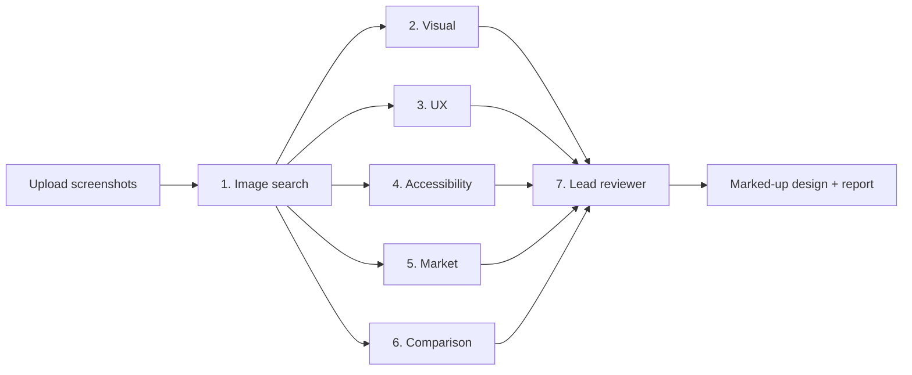

<p align="center"></p>

# DesignMind AI

Upload up to 3 screenshots of your product and get a design review in a few minutes. Six AI reviewers check the visuals, usability, accessibility and market, then pin the most important fixes onto your screenshots.

Built with Next.js, the Vercel AI SDK and OpenRouter. Runs on Vercel.

## How it works



| Step | What it does |
| --- | --- |
| 1. Image search | Describes each screen and finds similar, well-rated apps on the web |
| 2. Visual analysis | Layout, spacing, colour, type and hierarchy |
| 3. UX critique | Scores Nielsen's 10 usability heuristics |
| 4. Accessibility | Measures colour contrast from the pixels (WCAG 2.2) and estimates target sizes |
| 5. Market research | Searches the web for the top competitors and trends, with sources |
| 6. Design comparison | Picks the stronger screen in each area |
| 7. Lead reviewer | Removes repeats, ranks the fixes and scores each screen |

Steps 2–6 run at the same time. Results show as numbered pins on your screenshots plus 7 tabs, and you can export a PDF or JSON. The **See an example** page has a finished review and a short product tour video.

## Run it locally

You need Node.js 22 or newer.

```bash
npm install
cp .env.example .env.local   # add your OpenRouter key after OUTSKILL_OPENROUTER_API_KEY=
npm run dev                  # open http://localhost:3000
```

## API keys

The app uses one OpenRouter key, in one of two ways:

- **Outskill key (default):** the server reads `OUTSKILL_OPENROUTER_API_KEY`. Visitors don't need to set anything up.
- **Bring your own key:** a visitor pastes their own OpenRouter key on the home page. It's kept only in that browser tab and is never stored or logged.

A bring-your-own-key request never falls back to the Outskill key. Set a credit limit on the Outskill key in OpenRouter, because anyone with the site URL can use it.

## Deploy to Vercel

1. Import this repo at [vercel.com/new](https://vercel.com/new).
2. Add the environment variable `OUTSKILL_OPENROUTER_API_KEY`.
3. Click **Deploy**. Each push to `main` redeploys automatically.

## Tests

```bash
npx playwright install chromium   # first time only
npm run test:responsive           # checks mobile, laptop and desktop layouts
```

To see a finished review without a key, open **See an example** in the app.

## Limitations

- Reviews are saved only in the browser that created them.
- Target sizes are estimates. Small, thin text can measure slightly low, so near-misses are marked "Borderline".
- A full review takes about 2–3 minutes. Check the OpenRouter Activity page for what it costs.

## Credits

The visual review's craft criteria paraphrase Anthropic's [frontend-design skill](https://github.com/anthropics/skills/tree/main/skills/frontend-design) (Apache-2.0).

## License

[MIT](LICENSE) © 2026 Raees Basheer
