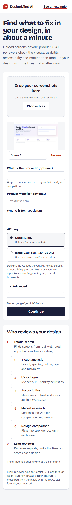
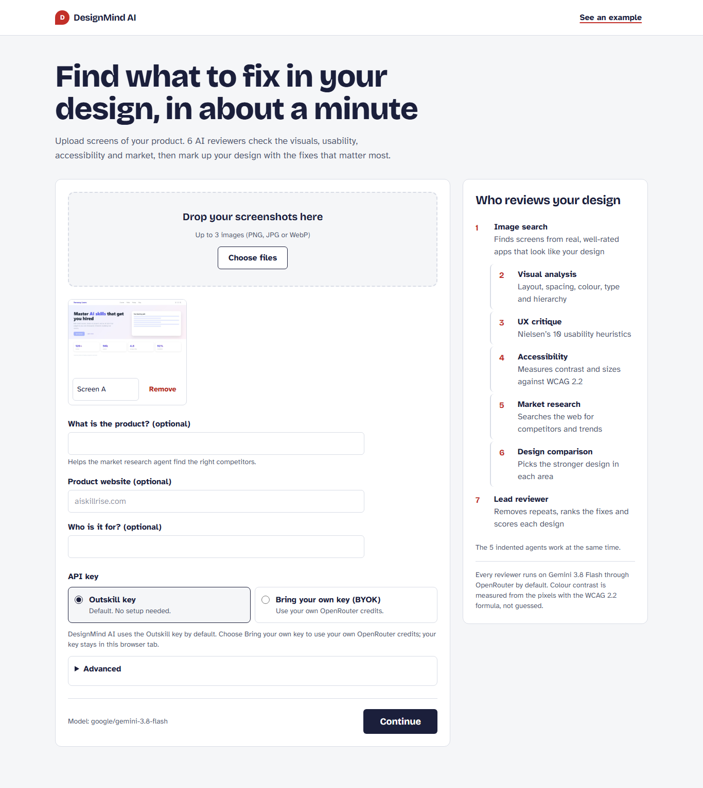
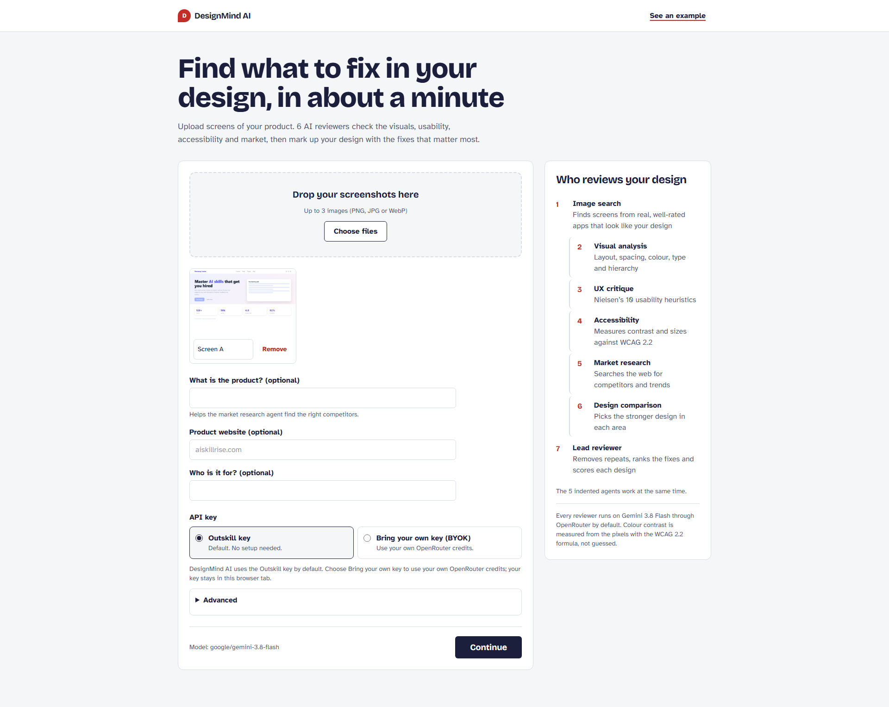
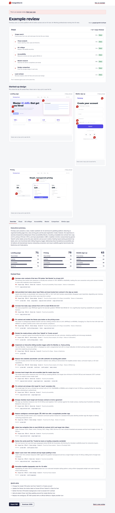
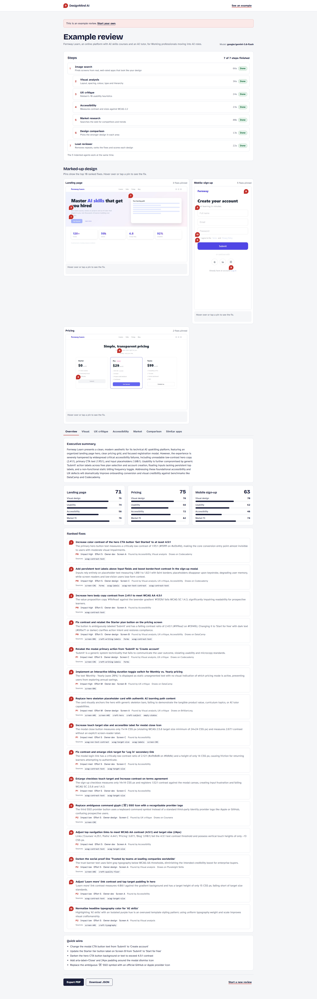
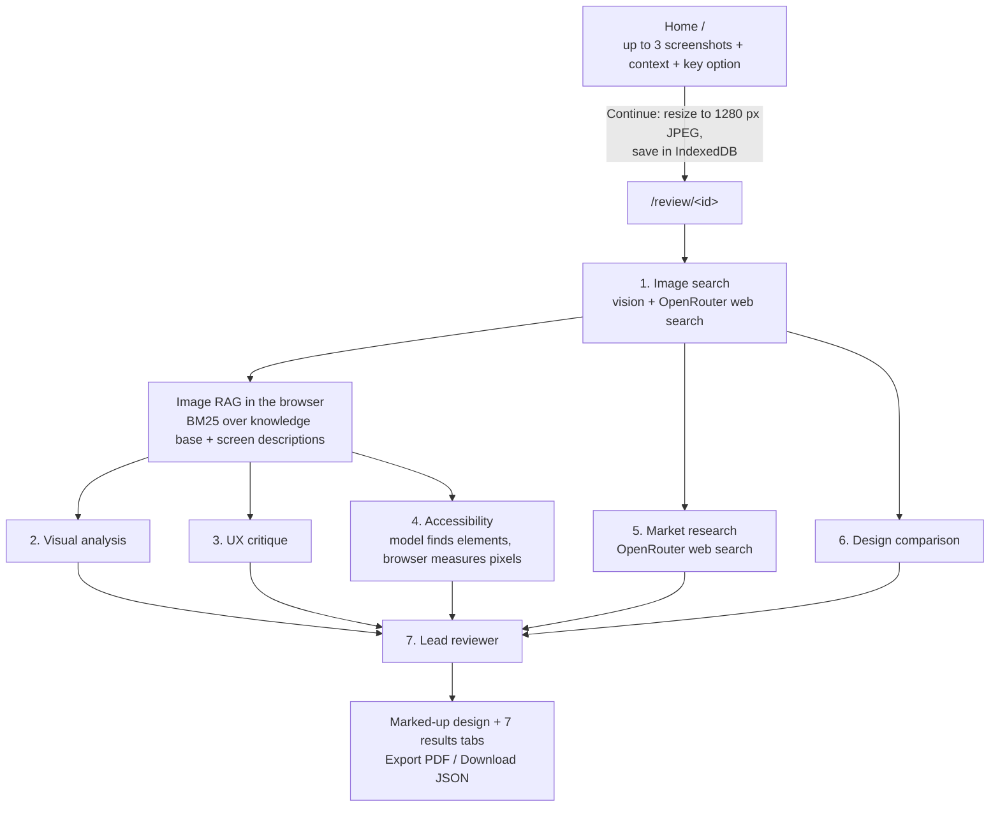

# DesignMind AI

A multimodal AI design analysis suite. Upload up to 3 screenshots of your own product and add its name, website and audience if you like. 6 AI reviewers check the visuals, usability, accessibility and market, then mark up your design with the fixes that matter most.

- **Reference search:** finds similar, well-rated apps with real web search.
- **Five reviewers that work at the same time:** visual analysis, UX critique, accessibility, market research and design comparison.
- **A lead reviewer** that removes repeats, ranks the fixes and scores each screen.

Built with Next.js (App Router), the Vercel AI SDK v7, OpenRouter and Tailwind CSS. It deploys to Vercel.

| Mobile | Laptop | Desktop |
| --- | --- | --- |
|  |  |  |
|  |  |  |

## Architecture



- The review page runs the steps from the browser: step 1, then steps 2–6 together with `Promise.allSettled`, then step 7.
- Each step is a separate `POST /api/agents/[agent]` call, so every serverless function stays well inside Vercel's time limit and a failed step can be retried on its own.
- Every status change and result is saved to IndexedDB under the review ID. A reload resumes: finished steps load from storage and unfinished steps run again.
- If step 1 fails, steps 2–6 still run without reference apps or screen descriptions, and the results say so.
- **Image RAG:** the index holds about 30 design best-practice entries (Nielsen's heuristics, WCAG 2.2 AA, Gestalt, forms, navigation, states, responsive layout), 10 `craft-*` entries and step 1's dense text description of each screen. A tiny in-browser BM25 search ([lib/retrieval.ts](lib/retrieval.ts)) retrieves the top 8 chunks for steps 2, 3 and 4, which must cite their IDs. Steps 1 and 5 cite the web pages their searches returned, and step 7 carries every citation into the results. Each of those steps shows its chunks under **Retrieved context**.

## The two key options

OpenRouter is the only provider and the only key.

| | Option 1: Outskill key (default) | Option 2: Bring your own key (BYOK) |
| --- | --- | --- |
| Setup | None | Paste your OpenRouter key, optionally click **Test key** |
| Request header | No key header is sent | `x-openrouter-key: <your key>` to our own `/api/*` routes only |
| Key used on the server | `process.env.OUTSKILL_OPENROUTER_API_KEY` | Your key, for that request only |
| Label on the review page | Key in use: Outskill key | Key in use: Your key |

Rules, applied in [lib/keys.ts](lib/keys.ts):

- If the request has an `x-openrouter-key` header, that key is used. An empty header is rejected.
- Otherwise the Outskill key is used. If it isn't set, the app returns "Outskill key not configured. Choose Bring your own key."
- A BYOK request never falls back to the Outskill key. A 401 or 402 is shown as a clear error.
- Responses return only `keySource` (`outskill` or `user`), never a key. Errors are sanitized before they reach a response or a log.
- The chosen option and any BYOK key live in `sessionStorage` only, never in IndexedDB. The Outskill key is read only on the server and has no `NEXT_PUBLIC_` prefix.
- Work per review is capped: at most 3 images, and steps 1 and 5 each use `max_tool_calls: 5` and `max_total_results: 15`.

## The 7 steps

Every reviewer runs on `google/gemini-3.8-flash` by default. Change it under **Advanced** on the home page: presets are `anthropic/claude-haiku-5.5`, `openai/gpt-6-luna` and `anthropic/claude-sonnet-5.5`, or enter a custom model ID. Each step has its own system prompt and Zod schema in [lib/agents.ts](lib/agents.ts). Structured output uses `generateText` with `Output.object`, retried once on `AI_NoObjectGeneratedError`. Every finding that points at part of a screen carries `screenRef` (A/B/C) and a `box` `[x, y, width, height]` in 0–1000 coordinates.

1. **Image search** (vision + web search): writes a dense 150–250 word `retrievalDescription` per screen for the RAG index, and infers the product category and audience. It also finds up to 5 real, well-rated similar apps, each with a source URL and a rating only if a search result states it. Apps without a cited source are dropped, and no third-party images are shown.
2. **Visual analysis** (vision + retrieved chunks + every `craft-*` entry): per screen, it covers layout, spacing, palette, typography, hierarchy and components. It adds a craft scorecard (distinctiveness, typography, colour system, structure, restraint, UX writing), the templated look and the signature element.
3. **UX critique** (vision + retrieved chunks): scores each screen 1–5 on Nielsen's 10 heuristics and lists issues, which you can filter by severity.
4. **Accessibility** (vision + pixel measurement): the model finds up to 25 text elements and targets per screen but never judges contrast. [lib/contrast.ts](lib/contrast.ts) measures each box on a canvas:
   - The most common colour is the background, and the text colour is the average of the pixels that contrast most with it.
   - The WCAG 2.2 ratio `(L1 + 0.05) / (L2 + 0.05)` is checked against 4.5:1, or 3:1 for large text and icons.
   - Target size is estimated in CSS px, assuming a 390 px-wide viewport for portrait screenshots and 1440 px for landscape, and checked against 24×24.
   - Failed measurements become issues with a suggested passing colour. A fail within 15% of the threshold is marked **Borderline**, because anti-aliasing can make thin text measure slightly low.
5. **Market research** happens in two calls:
   - 5a is one web-search call that identifies the top 3 direct competitors and current design and market trends.
   - 5b structures those notes into competitor cards, trends, a feature-gap matrix and differentiation opportunities.
   - Every competitor and trend must cite a URL that the search returned. Uncited claims are dropped, and fewer than 3 competitors are reported honestly, never invented. It returns a search trace with the number of searches and the cited URLs.
6. **Design comparison** (vision): with 2–3 screens, it picks the stronger screen in visual design, usability, accessibility and clarity of purpose. With 1 screen, it compares against step 1's similar apps and says so.
7. **Lead reviewer** (text only): removes repeated findings, then ranks up to 15 fixes. Each fix has a priority, impact, effort, owner, screen, the steps that found it and the app it draws on. Each pin is placed on the box of the finding it came from. The step also scores each screen 0–100 and writes an executive summary, quick wins and any gaps.

### Web search

Steps 1 and 5 call `POST https://openrouter.ai/api/v1/chat/completions` directly ([lib/web-search.ts](lib/web-search.ts)) with `tools: [{ type: "openrouter:web_search", parameters: { engine: "exa", max_results: 5, max_total_results: 15 } }]` and `max_tool_calls: 5`. The cited sources come back as `url_citation` annotations. The engine is pinned to **Exa** because Gemini's native search returns temporary `vertexaisearch` redirect links instead of real page URLs, which would break source checking. OpenRouter reports the number of searches in `usage.server_tool_use_details.web_search_requests`, and the code reads that or `usage.server_tool_use.web_search_requests`.

## Local setup

You need Node.js 22 or newer.

```bash
npm install
cp .env.example .env.local     # then add your key after OUTSKILL_OPENROUTER_API_KEY=
npm run dev                    # http://localhost:3000
npm run test:responsive        # builds, starts on port 3100 and runs Playwright at 3 sizes
```

The first Playwright run needs a browser: `npx playwright install chromium`.

## Testing

1. **Set up keys.**
   - Outskill key (Option 1): in Vercel, go to Project → Settings → Environment Variables and add `OUTSKILL_OPENROUTER_API_KEY`. For local runs, put it in `.env.local`, which is never committed. Set a credit limit on this key in OpenRouter.
   - Your own test key (Option 2): at openrouter.ai → Settings → API Keys, create `designmind-ai-test` with a credit limit (for example, $5).
2. **Check costs.** A review should cost roughly 10–20 US cents: tokens for 7 steps with Gemini 3.8 Flash, plus up to 10 web searches (about $0.007 each with Exa). These are estimates. Exa also returns page excerpts that count as prompt tokens: one market-research search call alone cost about $0.05 in our tests. Check the real cost on the OpenRouter Activity page after the first review.
3. **Test locally:**
   1. Run `npm run dev`.
   2. Open **See an example** and check every tab.
   3. Back on `/`, leave **Outskill key** selected, add 3 screenshots of your product with its name and website, and click **Continue**. Watch the 7 steps finish, and reload once partway through.
   4. Check the pins, every tab, **Export PDF** and **Download JSON**, then click **Start a new review**.
   5. Switch to **Bring your own key**, paste your key, click **Test key** and run another review. Confirm the label shows "Your key".
4. **Test on the deployed site:** repeat step 3 on the Vercel URL. Then run the same screenshots once with `anthropic/claude-haiku-5.5` and compare. Keep Gemini 3.8 Flash as the default unless Haiku's critique is just as specific.
5. **Test responsiveness:** run `npm run test:responsive`, review the screenshots in `tests/screenshots/` at all three sizes, and open the live URL on a real phone.
6. **Check accessibility measurements:** upload a screenshot with a known low-contrast button. Confirm the measured ratio is close to a contrast checker's result for the same two colours.
7. **Check key safety:**
   - Search the built JS and the page source for `sk-or-`. It must not appear.
   - In DevTools → Network, a BYOK key appears only in the `x-openrouter-key` header of requests to our own `/api/*` routes. With Option 1, no key header is sent at all.
   - In DevTools → Application → IndexedDB, no key is stored.
   - No key appears in Vercel's Runtime Logs.
8. **Try the failure cases:**
   - BYOK with a wrong key: confirm there's no silent fallback.
   - BYOK with an empty key.
   - The Outskill variable removed.
   - A text-only custom model.
   - A review link opened in a private window.
9. **After the hackathon,** delete or rotate both keys.

## Deploy to Vercel

1. Push to GitHub:
   ```bash
   gh repo create designmind-ai --public --source=. --push
   ```
2. On vercel.com, go to **Add New → Project** and import the `designmind-ai` repo. Keep the Next.js defaults and check that the Node.js version is 22.x or newer (`package.json` sets `"engines": { "node": ">=22" }`). Add the `OUTSKILL_OPENROUTER_API_KEY` environment variable and click **Deploy**.
3. Alternatively, from the command line: `npx vercel --prod`.

Every push to `main` redeploys automatically. The agents route sets `maxDuration = 120`: steps 1 and 5 run several web searches, and each step also budgets its own calls to finish inside that limit.

## Project structure

```
app/layout.tsx, app/globals.css      header (logo, See an example, Skip to content), theme
app/page.tsx                         home page
app/review/[id]/page.tsx             progress, then results
app/examples/example-compare/        finished example from tests/fixtures/sample-result.json (no API calls)
app/api/agents/[agent]/route.ts      one dynamic route for all 7 steps
app/api/test-key/route.ts            checks a BYOK key (valid, label, limit_remaining)
lib/keys.ts                          key resolution and error sanitizing
lib/agents.ts                        system prompts, Zod schemas and run function per step
lib/web-search.ts                    OpenRouter web search call (steps 1 and 5)
lib/contrast.ts                      WCAG 2.2 contrast from pixels, target-size estimates
lib/retrieval.ts, lib/knowledge.ts   chunking + BM25, design knowledge base
lib/pipeline.ts                      browser orchestration, resume and retry
lib/review-store.ts                  IndexedDB reviews, sessionStorage key settings, image resizing
lib/report-pdf.ts                    PDF export (jsPDF + autotable) and JSON download
lib/steps.ts                         step list and shared types
components/                          UploadForm, KeyOptions, ReviewersList, StepProgress,
                                     ResultsTabs, MarkedUpScreen, ReviewResults
tests/responsive.spec.ts             Playwright at 375×812, 1366×768 and 1920×1080
```

The example review is a real pipeline run (Gemini 3.8 Flash, Exa search) on three screens of **Fernway Learn**, a fictional product made for this demo. Its screenshots are in `public/examples/`.

## MVP limitations

- Reviews are saved only in the browser that created them. A review link opened elsewhere shows "This review isn't saved in this browser."
- Target sizes are estimates from the screenshot width, not exact CSS sizes.
- Contrast is measured from rendered pixels. Small, thin text can read slightly lower than its CSS colour, so near-threshold fails are marked Borderline.
- A full review takes about 2–3 minutes in our tests, mostly because of the two web-search steps (about 55–70 s each), not the 30–90 s the on-screen line suggests.
- There are no per-visitor rate limits or access code on the Outskill key, so set a credit limit on it in OpenRouter.
- Out of scope: Figma, PDF uploads, more than 3 screenshots, other providers, server-side storage, accounts and streaming.

## Credits

The visual-analysis craft lens paraphrases the principles of Anthropic's [frontend-design skill](https://github.com/anthropics/skills/tree/main/skills/frontend-design), licensed under Apache-2.0 (see its `LICENSE.txt`). The `craft-*` entries in [lib/knowledge.ts](lib/knowledge.ts) are short paraphrases, not copies.
